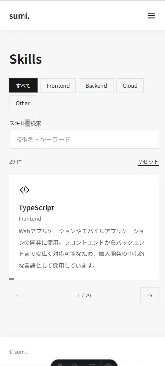
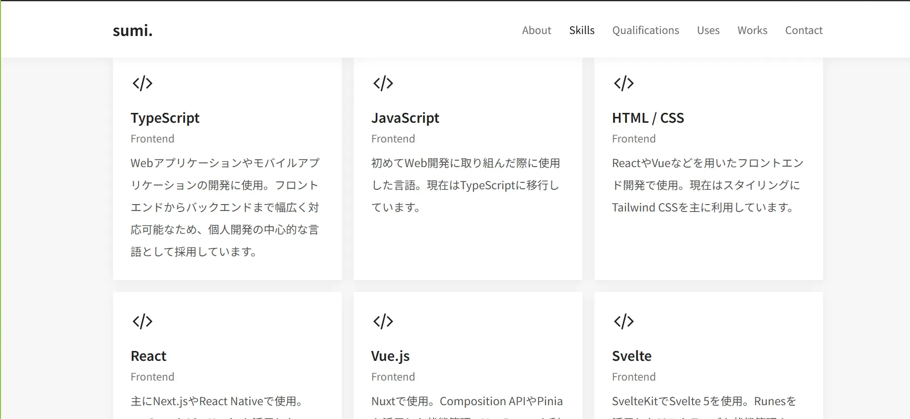
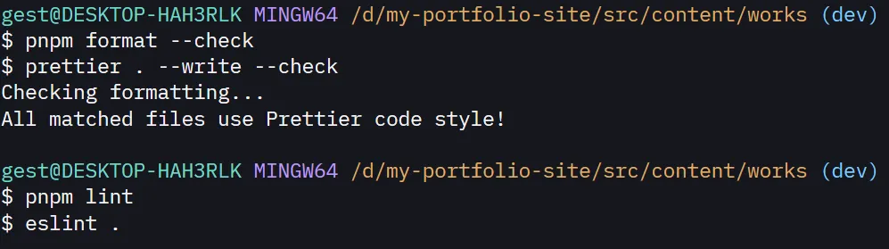
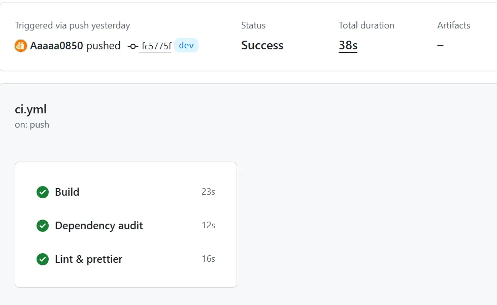
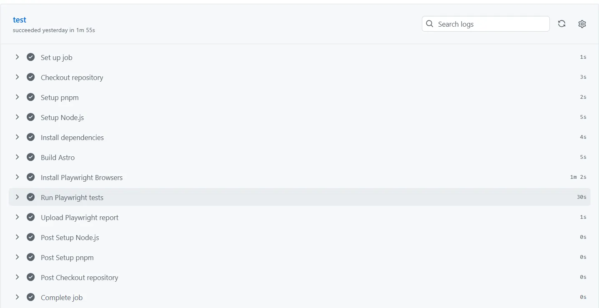

## 概要

私のプロフィールや技術、資格、開発環境をまとめたポートフォリオサイトです。

## 制作背景・目的

今回のポートフォリオサイトは、これまで学んできた技術や取得した資格、開発経験などを整理し、他の人に見てもらうために制作しました。

また、自分の技術力や経験をアピールし、就職活動やフリーランスとしての仕事の獲得に役立てることを目的としています。

## 主な機能

主な機能としては、以下のようなものがあります。

- **プロフィール（About）**：自己紹介やこれまでの経歴、プログラミングを始めたきっかけなどを掲載するページ
- **スキル（Skills）**：これまで使用してきたプログラミング言語やフレームワークなどを一覧で表示するページ
- **資格（Qualifications）**：取得した資格や合格した国家試験を一覧で表示するページ
- **開発環境（Uses）**：普段使用しているエディタや開発ツールなどを紹介するページ
- **作品（Works）**：これまでに制作した作品や、技術検証の成果を紹介するページ
- **お問い合わせ（Contact）**：お問い合わせフォームから連絡できるページ

## 技術選定

今今回のポートフォリオサイトではAstro、TypeScript、Tailwind CSS、React、Motion, Formspree, Cloudflare Pages, Cloudflare Turnstile, Playwright, ESLint, Prettierなどを主な技術として使用しています。

### Astro

Astroを選定した理由は、今回制作したポートフォリオサイトは静的コンテンツが中心であり、Reactは一部でしか利用しないため、AstroのIslands Architectureが適していると考えたからです。  
Next.jsやNuxt.js等のフレームワークも検討しましたが、今回の要件ではSSRなどの機能は必要なく、サイト全体をReactやVueで構築する必要もないと判断したため、Astroを採用しました。

### Tailwind CSS

Tailwind CSSを選定した理由は、スタイルを別のCSSファイルに分けず、コンポーネント内でユーティリティクラスを使って指定できるため、開発効率が向上すると考えたからです。

### Motion

Motionを選定した理由は、Reactとの相性が良く、アニメーションを簡単に実装できると考えたからです。  
特に、スキルの検索やフィルタリングを行った際、表示内容が突然切り替わることが気になったため、Motionを利用して滑らかに切り替わるようにしました。

### Formspree

Formspreeを選定した理由は、フォーム送信のためのバックエンドを自分で実装する必要がなく、簡単にお問い合わせフォームを設置できると考えたからです。これにより、開発や運用の手間を減らせるほか、スパム対策などの機能を利用できる点も採用理由の一つです。
また、Formspreeは無料プランでもフォームの送信数が月に50件まで利用できるため、今回のポートフォリオサイトでは十分であると判断しました。

### Cloudflare Turnstile

Cloudflare Turnstileを選定した理由は、お問い合わせフォームのスパム対策として、ユーザーの認証操作をできるだけ減らし、負担を抑えながらスパム対策ができると考えたからです。  
また、Formspreeと連携することで、簡単にお問い合わせフォームに組み込むことができるため、Cloudflare Turnstileを採用しました。  
さらに、Cloudflare Turnstileは無料で利用できるため、コストを抑えられると考えました。

## UI・UX設計

### デザイン方針

今回はスキルや資格、開発環境などの情報を主に見てほしいため、余計な装飾を減らし、シンプルで見やすいデザインを意識しました。
主に、白と黒、灰の3色を基調としたモノクロの配色にしました。  
また、フォントはGoogle Fontsの「Noto Sans JP」を使用し、可読性を高めるようにしました。  
そして、各ページの内容が見やすくなるように、余白を多めにとるようにしました。

### レスポンシブ対応

今回のポートフォリオサイトは、スマートフォンやタブレットなどの様々なデバイスで閲覧されることを想定して、レスポンシブ対応を行いました。  
特にSkillsページではモバイル端末の閲覧時に、縦リストの状態ではスキルの検索やフィルタリングがしづらくなるため、カルーセル形式にしてスキルを表示するようにしました。

デスクトップ表示では、モバイル端末よりも画面の横幅を広く使えるため、一覧性を優先し、グリッド形式でスキルを表示するようにしました。

## コンポーネント設計

今回はFeature-basedの考え方を採用し、各ページの機能ごとにコンポーネントを分けて設計しました。これにより、機能ごとの役割を明確にし、コードの管理や修正をしやすくすることを意識しました。  
HeaderやFooterなどの共通コンポーネントはLayout.astroで呼び出し、各ページで共通のレイアウトを使用できるようにしました。ページ固有のコンポーネントは、機能ごとにディレクトリを分けて管理しています。  
また、Worksの詳細ページはWorkDetailPage.astroにまとめました。AstroのContent Collectionsを利用して記事をMarkdownで管理し、WorkDetailPage.astroで表示する構成にしました。

## テスト・品質管理

今回は、Playwrightを使用して、Skillsページの検索やフィルタリングが正しく動作するかをテストしました。  
また、ESLintによる静的解析を行い、Prettierを使用してコードのフォーマットを統一することで、コードの品質を保つようにしました。  

さらに、GitHub Actionsを使用して、コードのプッシュ時やプルリクエストの作成時に、PlaywrightによるE2EテストやESLintによる静的解析、Prettierによるフォーマットチェックが自動で実行されるように設定しました。

## デプロイ・運用

今回はCloudflare Pagesを使用してサイトをデプロイしました。GitHubリポジトリと連携することで、コードのプッシュ時に自動でビルド・デプロイが行われるように設定しました。  
また、静的サイトであるため、サーバーの運用や管理の手間が少なく、運用しやすい構成になっています。  
さらに、Cloudflare Pagesは無料プランでも静的コンテンツへのリクエストが無制限であり、アクセス数によるコストを抑えられるため、採用しました。

## 開発中の課題と対応

今回、Cloudflare Pagesにサイトを公開する際、ローカル環境とCloudflare側でpnpmのバージョンが異なっており、ビルドに失敗して公開できない問題が発生しました。  
この問題に対して、Cloudflare Pagesのビルド設定でpnpmのバージョンを指定し、pnpm-workspace.yaml の設定も見直すことで、正常にビルドできるようにしました。  
また、ContactページではCloudflare Turnstileが正しく動作するかを確認するため、OpenCodeのGLM 5.3 Flashを使用したブラウザ操作によるフォーム送信テストを行いました。  
その結果、AIエージェントによる操作でもTurnstileが自動承認され、フォームを送信できることが分かりました。また、当初はFormspree側でTurnstileの検証が有効になっていなかったため、設定を見直しました。  
その後、通常のフォーム送信とメール通知が正常に動作することを確認しました。
